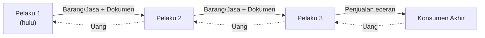
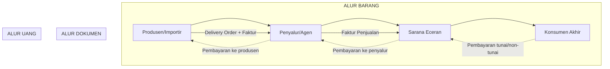
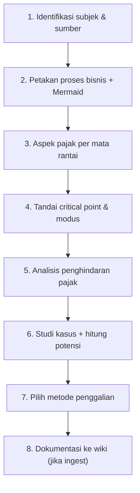

# /profil-proses-bisnis

Buat **Profil Proses Bisnis & Penggalian Potensi Perpajakan** — dokumen terstruktur yang
memetakan bagaimana sebuah usaha (wajib pajak / kelompok usaha / KLU) beroperasi,
menemukan titik-titik di mana kewajiban pajak muncul, menandai titik rawan (critical point)
beserta modus kecurangan yang mungkin terjadi, lalu menghitung dan menggali potensi pajaknya.

Terdiri dari **5 bagian wajib**:

| # | Bagian | Isi |
|---|--------|-----|
| 1 | **PROSES BISNIS** | Alur rantai pelaku, barang/jasa, uang, dan dokumen — **wajib dengan Mermaid diagram** |
| 2 | **ASPEK PERPAJAKAN — CRITICAL POINT / MODUS** | Peta pajak tiap mata rantai + titik rawan & modus kecurangan |
| 3 | **PENGHINDARAN PAJAK** | Pola penghindaran/pengelakan yang relevan dengan proses bisnis tsb |
| 4 | **STUDI KASUS** | Ilustrasi angka: kewajiban pajak vs realita → potensi pajak |
| 5 | **METODE / TEKNIK PENGGALIAN POTENSI** | Cara memperoleh data & menguji potensi di lapangan |

## Kapan digunakan

- User meminta "profil proses bisnis", "probis", "penggalian potensi pajak",
  "peta potensi", "modus pajak", "critical point", atau analisis serupa
- Ingest sumber baru yang menggambarkan suatu KLU/jenis usaha (mis. dokumen
  penjelasan teknis peredaran BBM, konstruksi, jasa, e-commerce, dll.)
- Menyusun bahan penelitian/pemeriksaan pajak dari sisi proses bisnis

## Langkah kerja

1. **Tentukan subjek & sumber** — WP/kelompok usaha apa, KLU/KBLI-nya, dan dari mana
   datanya berasal (sumber raw, hasil wawancara, dokumen perpajakan, data KLU).
2. **Petakan proses bisnis** → gambar alur Mermaid (Bagian 1).
3. **Petakan aspek pajak per mata rantai** → tabel + tandai critical point/modus (Bagian 2).
4. **Analisis penghindaran pajak** yang mungkin terjadi pada alur tsb (Bagian 3).
5. **Susun studi kasus** dengan ilustrasi angka (Bagian 4).
6. **Pilih metode/teknik penggalian** yang paling cocok untuk kasus tsb (Bagian 5).
7. **Dokumentasikan** — jika ini bagian dari ingest sumber baru, ikuti alur `AGENTS.md`
   (buat halaman di `wiki/concept/probis/`, update `_learning-path.md`, `index.md`, `log.md`).

> Jika subjek belum jelas (jenis usaha, KLU, atau sumber datanya), tanyakan dulu ke user —
> jangan menebak. Jika sumber datanya adalah file di `raw/`, baca penuh dulu sebelum menulis.

---

## Bagian 1 — PROSES BISNIS (dengan alur)

Gambarkan bagaimana bisnis berjalan dari hulu ke hilir. Minimal harus mencakup:

- **Pelaku** di setiap mata rantai (produsen, importir, distributor/agen, pengecer, konsumen akhir)
- **Alur barang/jasa** (apa yang mengalir antar pelaku)
- **Alur uang** (siapa membayar siapa)
- **Alur dokumen** (faktur, delivery order, kontrak — dokumen fiskal yang relevan)

**WAJIB** sertakan diagram Mermaid. Template dasar:

````markdown

````

Untuk proses yang lebih kompleks gunakan subgraph (alur barang / alur uang / alur dokumen
dipisah), misalnya:

````markdown

````

> Contoh nyata di wiki: [[47301-perdagangan-eceran-bahan-bakar-di-sarana-pengisian-bahan-bakar]].

---

## Bagian 2 — ASPEK PERPAJAKAN — CRITICAL POINT / MODUS

Untuk **setiap mata rantai** pada Bagian 1, tuliskan aspek perpajakannya dalam tabel:

| Mata rantai | Transaksi | Jenis pajak | Tarif / DPP | Final? | Pungut/potong oleh | Kewajiban admin (setor-lapor) | **Critical point** | **Modus potensial** |

Isi kolom terakhir dengan:

- **Critical point** = titik dalam alur di mana kewajiban pajak rawan tidak terpenuhi
  (mis. penjualan tunai tanpa bukti, pemecahan omzet, transaksi antar afiliasi,
  penyerahan yang tidak dilaporkan, faktur tidak diterbitkan, pembayaran ke luar negeri).
- **Modus potensial** = pola kecurangan khas dari jenis usaha tsb, ditulis singkat
  (lihat daftar umum di bawah, sesuaikan dengan alurnya).

Daftar modus umum yang sering muncul (gunakan hanya yang relevan & grounded pada sumber):
- Faktur pajak tidak diterbitkan / FP fiktif (faktur tanpa transaksi)
- Pemecahan omzet ke beberapa NPWP / badan untuk tetap di PP 23 atau batas PKP
- Mark-up biaya / meminjam bukti potong (PPh 21/23/26) palsu
- Under-invoicing / split payment pada impor atau penjualan
- Penjualan tunai tidak dicatat (cash business tanpa point of sale)
- Transfer pricing antar pihak afiliasi (jual di bawah harga pasar)
- Tidak memotong PPh 26 atas pembayaran ke luar negeri, dll.

**Setiap klaim wajib diberi referensi** ke sumbernya (`(sumber: nama-file)`). Jika tidak ada
sumber untuk sebuah modus, tandai `[perlu verifikasi]`.

---

## Bagian 3 — PENGHINDARAN PAJAK

Bedakan dan uraikan dua hal, sesuai proses bisnis yang dianalisis:

1. **Penghindaran pajak (tax avoidance)** — legal, memanfaatkan celah ketentuan,
   mis. treaty shopping, thin capitalization, perencanaan struktur kepemilikan,
   pemilihan bentuk usaha, pemanfaatan insentif/fasilitas.
2. **Penggelapan pajak (tax evasion)** — melanggar ketentuan, mis. tidak melapor,
   faktur fiktif, menyembunyikan omzet.

Untuk tiap pola yang relevan: jelaskan **mekanismenya** (bagaimana dilakukan dalam alur
bisnis tsb), **ketentuan yang dimanfaatkan/dilanggar**, dan **indikator deteksi**-nya.
Jika sumber tidak membahas penghindaran pajak secara eksplisit, tulis analisis sebagai
kesimpulan beralasan dari Bagian 2 dan tandai `[analisis — perlu verifikasi]`.

---

## Bagian 4 — STUDI KASUS

Buat ilustrasi angka yang konkret (angka hipotetis wajar, diberi label hipotetis) dengan
struktur:

1. **Latar belakang** — profil WP singkat (jenis usaha, omzet, status PKP/NPKP)
2. **Fakta** — transaksi atau kondisi yang memicu potensi (dari critical point terpilih)
3. **Analisis** — ketentuan yang dilanggar/dimanfaatkan
4. **Hitungan** — pajak seharusnya vs pajak yang dilaporkan → **selisih = potensi pajak**
5. **Kesimpulan** — besaran potensi dan tindak lanjut yang disarankan

Contoh format hitungan (PPN):

```
Penjualan tunai tidak dilaporkan : Rp 1.000.000.000 (belum termasuk PPN)
PPN terutang 11% x 1.000.000.000 : Rp   110.000.000
PPN yang dilaporkan WP            : Rp           0
Potensi PPN                       : Rp   110.000.000
```

---

## Bagian 5 — METODE / TEKNIK PENGGALIAN POTENSI

Pilih & uraikan teknik yang cocok untuk menggali potensi dari proses bisnis tsb:

| Teknik | Kegunaan | Contoh penerapan pada kasus ini |
|--------|----------|----------------------------------|
| **Data matching / konfirmasi** | Mencocokkan SPT dgn data faktur, PIB, SPT lawan transaksi | Omzet SPBU vs pembelian BBM dari penyalur |
| **Uji kewajaran / benchmark** | Membandingkan rasio laba, marjin, konsumsi dgn usaha sejenis | Marjin eceran BBM vs rata-rata industri |
| **Observasi lapangan** | Melihat langsung praktik usaha, alur kas | Menghitung antrean/kapasitas vs omzet |
| **Wawancara** | Mengonfirmasi praktik & dokumen | Konfirmasi pembelian ke penyalur |
| **Uji harta & konsumsi** | Membandingkan penghasilan dgn kekayaan/gaya hidup | Pembelian aset > SPT penghasilan |
| **Analisis arus kas/bank** | Melacak penerimaan yang tidak dilaporkan | Setoran bank > omzet SPT |

Tulis teknik yang **paling relevan untuk kasus tsb** (jangan semua), lengkap dengan cara
mendapatkan datanya dan indikator hasil yang diharapkan.

---

## Alur kerja skill (ringkas)

Berikut diagram alur keseluruhan yang harus diikuti saat menjalankan skill ini:

````markdown

````

## Checklist kualitas

- [ ] Alur Mermaid tersedia di Bagian 1 (dan diagram alur kerja di atas jika diminta)
- [ ] Tabel Bagian 2 mencakup semua mata rantai dari diagram
- [ ] Critical point & modus ditautkan ke mata rantai spesifik (bukan daftar umum)
- [ ] Setiap klaim punya referensi sumber; klaim tanpa sumber ditandai `[perlu verifikasi]`
- [ ] Studi kasus punya hitungan selisih → potensi pajak yang jelas
- [ ] Jika disimpan ke wiki: frontmatter lengkap, masuk chapter `probis`, learning path & log diupdate
- [ ] Bahasa Indonesia, istilah pajak konsisten dengan halaman wiki lain (PPh 22/21/23/26/4(2), PPN, PBBKB, dll.)

## Referensi terkait di wiki

- [[47301-perdagangan-eceran-bahan-bakar-di-sarana-pengisian-bahan-bakar]] — contoh lengkap probis + peta pajak per mata rantai
- [[concept/probis/_learning-path]] — learning path chapter probis (KLU)
- [[concept/pemeriksaan-pajak/_learning-path]] — teknik pemeriksaan/pengujian yang mendukung penggalian