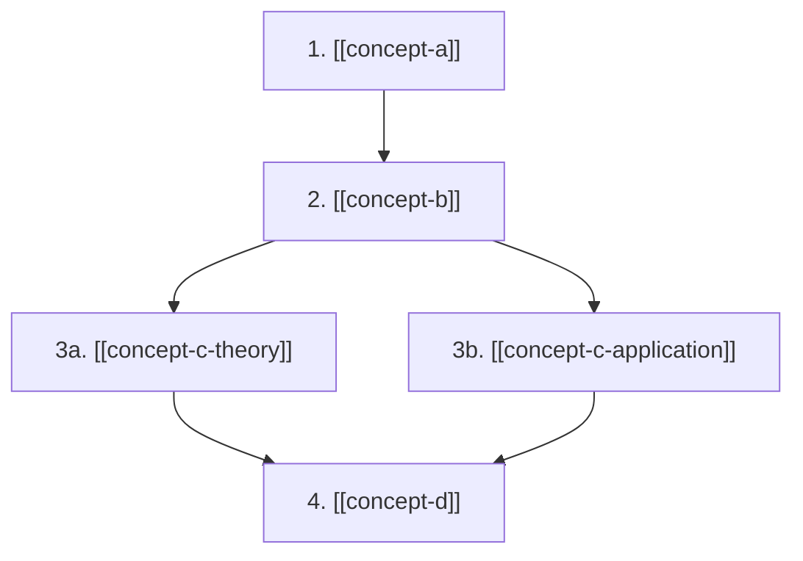
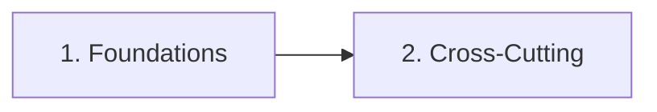
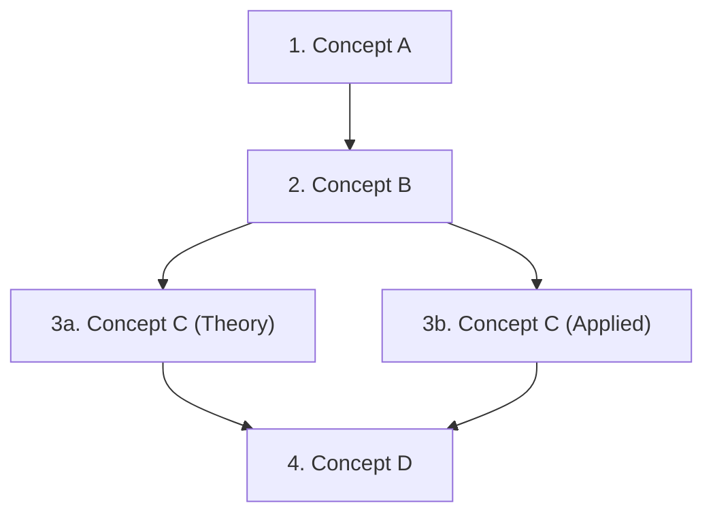

# LLM Wiki

A personal knowledge base maintained by AI Agent (pi, Opencode, Claude Code, etc).
Based on Andrej Karpathy's LLM Wiki pattern.

> **Architecture first**: Read `TAXWIKIDESIGN.md` before touching the knowledge-store,
> dataset, or fine-tuning infrastructure. It records the goals, decisions, and
> rationale (RAG + fine-tuned small model split, `.knowledge/` vs committed JSONL,
> training thresholds). This file covers day-to-day wiki operations.

## Purpose

This wiki is a structured, interlinked knowledge base for learning, thinking, and building understanding across any topic.
You are the AI Agent that maintains the wiki. The human curates sources, asks questions, and guides the analysis.

## Folder structure

```
raw/                    -- source documents (immutable -- never modify these)
raw/assets/             -- downloaded images and attachments for sources
wiki/                   -- markdown pages maintained by AI Agent
wiki/concept/           -- concept pages organized into chapter folders
  foundations/          -- fundamental concepts needed to master any topic
    _learning-path.md   -- learning path for foundational concepts
  cross-cutting/        -- concepts that bridge multiple chapter areas
    _learning-path.md   -- learning path for cross-cutting concepts
  <chapter-name>/       -- one folder per broad topic area (e.g. machine-learning/)
    _learning-path.md   -- structured curriculum for this chapter
    concept-a.md        -- individual concept pages
    concept-b.md
wiki/_learning-path.md  -- master learning path sequencing all chapters
wiki/index.md           -- table of contents + learning path index
wiki/log.md             -- append-only record of all operations
```

### Chapter organization

Concepts are grouped into **chapter folders** under `wiki/concept/`. Each chapter represents a broad topic area. Within each chapter, concepts are arranged into a **learning path** (`_learning-path.md`) — a structured, sequenced curriculum with branching support.

Two special folders exist outside the topic chapters:
- **`foundations/`** — Really fundamental basic concepts needed to master a topic (math, logic, scientific method, etc.). These are prerequisites that every learner should build first.
- **`cross-cutting/`** — Concepts that bridge multiple chapter areas and don't belong to a single topic (e.g., systems thinking, information theory). These appear as references in multiple learning paths.

## Ingest workflow

This workflow applies **only to new sources** that the user drops into `raw/` and asks to ingest.

**Rules**:
- Never re-ingest an already-ingested source unless the user explicitly says to re-ingest all
- Never create duplicate concept pages, summary pages, or learning path nodes for already-processed content
- If the user asks you to "reprocess" or "update" the wiki, ask whether they mean (a) ingest a new source, (b) re-ingest all sources, or (c) a lint pass
- Exception: re-ingest all is only triggered when the user says "reingest all" or "reprocess everything"

### Binary source preprocessing

Binary files (PDF, DOCX, PPTX, XLSX) cannot be read directly by the `read` tool.
They must first be converted to Markdown so the agent can ingest them.

**Recommended tool**: [`markitdown`](https://github.com/microsoft/markitdown) by Microsoft —
a lightweight, unified converter for all common document formats.

```bash
# Install
pip install "markitdown[pdf,pptx,xlsx]"

# Convert any binary source to Markdown (output to /tmp/ for agent to read)
python -m markitdown raw/source.pdf > /tmp/source.md
python -m markitdown raw/source.docx > /tmp/source.md
python -m markitdown raw/source.pptx > /tmp/source.md
python -m markitdown raw/source.xlsx > /tmp/source.md
```

Then read the converted file and proceed with the normal ingest steps below.

> **Fallback skills**: The `.agents/` directory contains detailed skills for
> each format (pdf, docx, pptx, xlsx) that prescribe alternative extraction methods
> (pypdf, pdfplumber, pandoc, python-pptx, openpyxl). Use them if `markitdown` fails
> on a specific file — load the relevant skill via `/skill:name` (pi) or let the
> agent auto-discover it.

1. Read the full source document
2. Discuss key takeaways with the user before writing anything
3. Create a summary page in `wiki/` named after the source
4. Create or update concept pages for each major idea or entity
5. **Classify each concept into a chapter folder** under `wiki/concept/` (see [Chapter organization](#chapter-organization))
6. **Update the chapter's learning path** (`_learning-path.md`) — insert new concept nodes in the correct sequence, update prerequisites, and add 3-5 sentence overviews per node
7. **If a new chapter folder was created**, update `wiki/_learning-path.md` (master path) — insert a node for the new chapter, positioned by its prerequisites and difficulty relative to existing chapters. Add branch points only when chapters naturally diverge in focus.
8. Add wiki-links ([[page-name]]) to connect related pages
9. Update `wiki/index.md` with new pages, learning path summaries, and one-line descriptions. **Check that the embedded `.base` views in `index.md` still cover the new content** — they auto-populate by tag/folder, so no manual entry is needed unless a new page type (tag or folder) is introduced, in which case create a new `.base` file for it.
10. Append an entry to `wiki/log.md` with the date, source name, and what changed
11. Write 5–10 grounded Q&A pairs per new/updated page to `dataset/qa-raw/<source-slug>.jsonl` (one ShareGPT record per line: system = answer-only-from-context, human = wiki page context + Indonesian tax question, gpt = cited answer). These accumulate the RAG-style training data.
12. Run `python tools/make-dataset.py` to refresh `dataset/*.jsonl`, then commit them together with the wiki changes.

A single source may touch 10-15 wiki pages. That is normal.

### Classifying concepts into chapters

When deciding where a concept belongs:
- If it's a **fundamental building block** needed to master a topic (math, logic, scientific method) → `foundations/`
- If it's used across **multiple chapter areas** without a clear primary home → `cross-cutting/`
- Otherwise → the **broad topic chapter** that best represents its primary domain

When uncertain, discuss with the user before placing.

## Page format

Every wiki page MUST use YAML frontmatter for metadata. This enables Dataview queries and obsidian-bases views later.

### Concept pages

```markdown
---
title: Page Title
tags: [concept, topic-area]
date: 2026-05-03
sources: [filename.md, another.pdf]
aliases: [Alternative Name]
status: draft
chapter: topic-area-name
---
# Page Title

**Summary**: One to two sentences describing this page.

---

Main content goes here. Use clear headings and short paragraphs.

Link to related concepts using [[wiki-links]] throughout the text.

## Related pages

- [[related-concept-1]]
- [[related-concept-2]]
```

### Learning path pages

Learning paths use a different format — see the [Learning Path System](#learning-path-system) section below for the full template.

### Frontmatter fields

| Field | Required | Description |
|-------|----------|-------------|
| `title` | Yes | Page title (same as H1) |
| `tags` | Yes | Categorization: `concept`, `source`, `summary`, `comparison`, `analysis`, `question`, `learning-path` |
| `date` | Yes | Date created or last significantly updated |
| `sources` | Yes | List of raw source files this page draws from |
| `aliases` | No | Alternative names for the concept (improves [[wikilink]] autocomplete) |
| `status` | No | `draft`, `review`, or `stable` — helps identify pages needing attention during lint
| `chapter` | No* | Which chapter folder this concept belongs to. *Required for concept pages; omit for learning paths and summary pages. |
| `difficulty` | No | `foundational`, `beginner`, `intermediate`, or `advanced` — used by learning paths to suggest pacing |
| `estimated_minutes` | No | Approximate study time for this concept node (used in learning path duration estimates) |

## Citation rules

- Every factual claim should reference its source file
- Use the format (source: filename.pdf) after the claim
- If two sources disagree, note the contradiction explicitly
- If a claim has no source, mark it as needing verification

## Question answering

When the user asks a question:

1. Read `wiki/index.md` first to find relevant pages
2. Read those pages and synthesize an answer
3. Cite specific wiki pages in your response
4. If the answer is not in the wiki, say so clearly
5. If the answer is valuable, offer to save it as a new wiki page

Good answers should be filed back into the wiki so they compound over time.

## Obsidian Bases integration

`.base` files provide database-like views over wiki pages. They **auto-populate** based on tag/folder filters — you create them once and they stay current as content is added. They complement `index.md` by offering filterable, sortable views without manual maintenance.

### Pre-created bases (existing)

These three bases are already in `wiki/` and embedded in `index.md`. They require no manual updating — new matching pages appear automatically:

| Base | Purpose | Filter | Location |
|------|---------|--------|----------|
| `source-inventory.base` | Table of all ingested sources | `file.hasTag("source")` | `wiki/source-inventory.base` |
| `concept-index.base` | Card view of concepts grouped by chapter | `file.hasTag("concept")` | `wiki/concept-index.base` |
| `lint-dashboard.base` | Draft pages, learning paths, and all pages with quality flags | `file.ext == "md"` | `wiki/lint-dashboard.base` |

### When to create a NEW base

Create a new `.base` file when:
- A new page **tag** is introduced that deserves its own dedicated view (e.g. `comparison`, `question`, `analysis`)
- A new **folder structure** is added that should be filterable
- An existing view needs a different **grouping or card layout** not covered by the pre-created bases

### How to create a base

1. Load the `obsidian-bases` skill for the full schema reference
2. Create a `.base` file in `wiki/` (e.g. `wiki/comparison-index.base`)
3. Filter by tags and folder: `file.hasTag("comparison")` or `file.inFolder("wiki/concept")`
4. Use frontmatter fields in `order` and `formulas` — all pages have `title`, `tags`, `date`, `sources`, `status`
5. Embed the new base in `wiki/index.md` with `![[comparison-index.base]]`

### How bases auto-populate during ingest

When you create or update a wiki page (step 4-8 of the ingest workflow):
- If the page has a tag that matches an existing base filter, it **appears automatically** in that base's views
- **No manual update** to the `.base` file is needed
- The only action required on your part is **step 9**: verify that `index.md` still covers the new content, and if a new tag/folder type was introduced, create a corresponding `.base` file

### Example: source inventory base

```yaml
filters:
  and:
    - file.hasTag("source")
    - file.inFolder("wiki")

formulas:
  source_count: 'sources.length'

views:
  - type: table
    name: "All Sources"
    order:
      - file.name
      - date
      - formula.source_count
      - status
      - tags
```

## Learning Path System

Learning paths exist at two levels:
- **Master path** (`wiki/_learning-path.md`) — sequences entire chapters. Updated only when the user asks to ingest a new source: new chapter = new node. No placeholders for nonexistent chapters.
- **Chapter paths** (`wiki/concept/<chapter>/_learning-path.md`) — sequences concepts within a chapter. Updated only when the user asks to ingest a new source.

Both are living documents — they grow, reorder, and branch as new sources are ingested. They are **never modified outside a new-source ingest workflow** unless the user explicitly asks to re-ingest all.

### Learning path format

```markdown
---
title: "Learning Path: Topic Area Name"
tags: [learning-path, topic-area]
date: YYYY-MM-DD
status: draft
chapter: topic-area-name
---
# Learning Path: Topic Area Name

**Overview**: A structured journey through [topic area]. By the end, you'll have a solid
understanding of X, Y, and Z. You'll be able to reason about A and apply B to real problems.

**Estimated duration**: ~X hours across Y nodes (including all branches).

**Prerequisite paths**: [[foundations/_learning-path]] (recommended before starting)

---

## Visual Overview



> **Note**: The Mermaid chart above is a visual guide. Click any node in Obsidian to open that page. Branch arrows show alternative learning paths; merge arrows show where branches reconverge.

---

## Path Sequence

### 1. [[concept-a]]
**Prerequisites**: None
**Difficulty**: beginner
**Overview**: (3-5 sentences) This concept introduces the foundational idea of...
Understanding this is critical because... You'll grasp why... and how it connects to...
By the end of this node, you should be able to explain... and recognize its role
in broader systems.

### 2. [[concept-b]]
**Prerequisites**: [[concept-a]]
**Difficulty**: beginner
**Overview**: (3-5 sentences)...

> **Branch point**: After node 2, choose your path:
> - **Path A (theory-focused)**: Continue to [[concept-c-theory]]
> - **Path B (application-focused)**: Continue to [[concept-c-application]]

### 3a. [[concept-c-theory]]  *(Path A)*
**Prerequisites**: [[concept-b]]
**Difficulty**: intermediate
**Overview**: (3-5 sentences)...

### 3b. [[concept-c-application]]  *(Path B)*
**Prerequisites**: [[concept-b]]
**Difficulty**: intermediate
**Overview**: (3-5 sentences)...

> **Merge point**: Both paths converge here before continuing.

### 4. [[concept-d]]
**Prerequisites**: [[concept-c-theory]] OR [[concept-c-application]]
**Difficulty**: intermediate
**Overview**: (3-5 sentences)...
```

### Branching rules

- **Branch points** use a `>` blockquote with bold label and bullet options
- **Merge points** use a `>` blockquote indicating convergence
- Node labels use suffixes (`3a`, `3b`) within a branch; numbering continues from the merge point
- Prerequisites at merge points use `OR` to indicate either branch satisfies the requirement
- Each branch should have a clear **theme** (e.g., theory vs. application, math-heavy vs. intuitive)

### When to introduce branches

- When a topic has distinct **sub-disciplines** (e.g., supervised vs. unsupervised learning)
- When there are **multiple valid learning orders** for a set of concepts
- When the learner might want to **specialize** (e.g., NLP vs. computer vision within ML)
- When a concept can be approached from **different angles** (e.g., practical coding vs. mathematical derivation)

### Visual overview chart (Mermaid)

Every learning path (master and chapter) **must include a Mermaid.js flowchart** in a
`## Visual Overview` section, placed between the header metadata and the `## Path Sequence` section.

**Rules for the Mermaid chart:**

- Use `graph LR` (horizontal) for linear sequences; `graph TB` (top-to-bottom) for paths with many branches or deep prerequisite chains.
- Node labels use the same numbering as the path sequence (e.g. `"1. Foundations"`).
- Arrows (`-->`) show dependencies: node A → node B means A is a prerequisite for B.
- Branch arrows fork from the branch-point node to each branch node.
- Merge arrows converge from multiple branch nodes into the merge-point node.
- Each node must have a `click` handler linking to the corresponding `.md` file, using a path relative to the learning path file. This makes nodes clickable in Obsidian.
- After a `click` handler, add a note below the chart explaining that nodes are clickable.

**Example — master path with linear chapters:**

````markdown
## Visual Overview



> **Note**: Click any node in the chart to open that chapter's learning path.
````

**Example — chapter path with branches:**

````markdown
## Visual Overview



> **Note**: Click any node in Obsidian to open that page. Branch arrows show alternative paths; merge arrows show reconvergence.
````

### Updating learning paths during ingest

This only runs during **new-source ingest**. Do NOT modify learning paths if the content already exists in the wiki — unless the user asks for re-ingest all.

After creating or updating concept pages from a new source:
1. Open the relevant `_learning-path.md`
2. Determine where the new concept fits in the sequence (what must come before? what depends on it?)
3. Insert the node with 3-5 sentence overview
4. Update the **Mermaid chart** in the `## Visual Overview` section (add the new node, connect arrows, add click handler)
5. Update prerequisites on downstream nodes if needed
6. If the new concept creates a natural fork, add a branch point
7. Update the **Estimated duration** and node count in the header
8. If a new chapter folder was created, update `wiki/_learning-path.md` (the master learning path) — add a node, update its Mermaid chart, and insert the new chapter node in the correct position. The master path is dynamic — it reflects only chapters that actually exist. Do not add placeholder nodes for chapters that haven't been created yet.

## Dataset accumulation (fine-tuning)

The wiki **accumulates its own training data** — see `dataset/README.md` for the full pipeline. Key rules:

- Every ingest produces gold pairs (`raw/` source → wiki pages) that `tools/make-dataset.py` mines into Unsloth-ready JSONL. **Re-run the builder after every ingest batch** (ingest step 12).
- Only pages with `status: stable` (or `review`) are used as training data. Draft pages are excluded — fix them via a lint pass first. The lint pass is also data cleaning.
- Q&A pairs for `dataset/qa-raw/` are written during ingest (step 11); the builder merges and dedupes them.
- Training runs on a GPU box (RunPod/Colab) with `dataset/train.py` — the 8GB laptop only runs the exported GGUF via Ollama. Train on a data trigger (~30+ sources first time), not on a schedule.
- Never modify `dataset/train.py` outputs or `raw/`; the generated `dataset/*.jsonl` are committed, downloaded model weights are gitignored.

## Lint

When the user asks you to lint or audit the wiki:

- Check for contradictions between pages
- Find orphan pages (no inbound links from other pages)
- Identify concepts mentioned in pages that lack their own page
- Flag claims that may be outdated based on newer sources
- Check that all pages follow the page format above
- Report findings as a numbered list with suggested fixes

## Rules

- Never modify anything in the `raw/` folder
- Always update `wiki/index.md` and `wiki/log.md` after changes
- Always update the relevant chapter `_learning-path.md` **only when ingesting a new source** (never for re-ingests unless the user asks for re-ingest all)
- Update `wiki/_learning-path.md` (master path) **only when ingesting a new source that creates a new chapter** — never modify it outside a new-source workflow
- Always include a **Mermaid visual overview chart** in every `_learning-path.md` — update it whenever nodes are added, removed, or reordered
- Use the `obsidian-markdown` skill to write Obsidian-compatible [[wikilinks]], callouts, and embeds
- Use the `obsidian-bases` skill to create filterable `.base` views of source inventories and concept indexes
- Use the `graphify` skill to build and query knowledge graphs after major ingests
- Keep page names lowercase with hyphens (e.g. `machine-learning.md`)
- Keep chapter folder names lowercase with hyphens (e.g. `machine-learning/`)
- Write learning path overviews in 3-5 sentences per node
- Write in clear, plain language
- When uncertain about how to categorize something, ask the user

## Coding Agent Setup

This repo is configured for multiple coding agents. The table below shows which agent uses which config files.

| Agent | Context file | Settings | Skills | Extensions/Plugins |
|-------|-------------|----------|--------|--------------------|
| **pi** | `AGENTS.md` | `.pi/settings.json` | `.agents/` (via `skills` in settings) | `.pi/extensions/graphify-gate.ts`, `.pi/extensions/utils.ts` |
| **Claude Code** | `CLAUDE.md` → `AGENTS.md` | `.claude/settings.json` | `.agents/` | `.opencode/plugins/graphify.js` |
| **OpenCode** | `AGENTS.md` | `.opencode/opencode.json` | `.agents/` | `.opencode/plugins/graphify.js` |

### Cross-agent notes

- **`CLAUDE.md`** is a symlink to `AGENTS.md` (`CLAUDE.md → AGENTS.md`). Both pi and Claude Code load it automatically. Updating `AGENTS.md` keeps all agents in sync.
- **Skills** in `.agents/` follow the [Agent Skills standard](https://agentskills.io) and work with **pi**, **Opencode**, and **Claude Code** without modification.
- **`.claude/settings.local.json`** is for local overrides (not committed). Add it to `.gitignore` if you use it.

### Per-agent details

#### pi

| File | Purpose |
|------|---------|
| `.pi/settings.json` | Project settings — references skills from `.agents/` and enables `/skill:` commands |
| `.pi/extensions/graphify-gate.ts` | Extension — reminds the model about the knowledge graph once per session (ported from `.opencode/plugins/graphify.js`) |
| `.pi/extensions/utils.ts` | Extension — registers `/vscode` and `/code` commands to open the repo in VS Code |

Use `/skill:name` to load a skill manually. Extensions auto-discover on startup or via `/reload`.

#### Claude Code

| File | Purpose |
|------|---------|
| `.claude/settings.json` | Project settings — `ignorePatterns` for files to exclude, `allowedTools` for permitted capabilities |
| `.claude/settings.local.json` | Local overrides (optional, not tracked in git) |

Claude Code reads `CLAUDE.md` automatically (symlinked to `AGENTS.md`).

#### OpenCode

| File | Purpose |
|------|---------|
| `.opencode/opencode.json` | Plugin config — loads `.opencode/plugins/graphify.js` |
| `.agents/` | Skills directory — shared by all agents |
| `.opencode/plugins/graphify.js` | Plugin — reminds the model about the knowledge graph |

### Graphify gate

The knowledge-graph reminder is implemented per-agent:
- **pi**: `.pi/extensions/graphify-gate.ts` (extension, tool_call event)
- **OpenCode**: `.opencode/plugins/graphify.js` (plugin, tool.execute.before hook)
- **Claude Code**: uses the `.opencode/plugins/graphify.js` plugin if applicable

## graphify

graphify creates a knowledge graph from the wiki's markdown content, detecting communities of related concepts, cross-references, and hidden connections between topics. Output lives in `graphify-out/`.

### When to use graphify

- **After every new-source ingest** — run `graphify update .` to rebuild the graph, reflecting new cross-references and concept updates. Do NOT re-run graphify unless a new source was ingested or the user asks for it.
- **Before answering complex queries** — read `graphify-out/GRAPH_REPORT.md` to find god nodes (hub concepts) and community clusters relevant to the question
- **When exploring cross-topic connections** — use `graphify path "<Concept A>" "<Concept B>"` to find the chain of intermediate concepts connecting two ideas
- **When discovering unexpected relationships** — use `graphify query "<question>"` to traverse the graph's extracted and inferred edges
- **When explaining a concept in context** — use `graphify explain "<concept>"` to get its neighborhood in the knowledge graph

### Rules

- The knowledge graph augments (not replaces) `wiki/index.md` for navigation — use both together
- Run `graphify update .` **only after a new-source ingest** (never for re-ingests unless the user asks for it)
- If `graphify-out/wiki/index.md` exists, prefer it for graph-based browsing of the wiki
- graphify operates on wiki markdown; it does not modify raw sources
