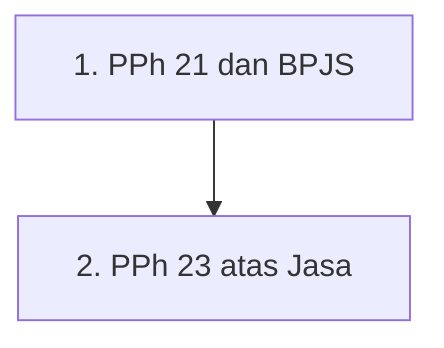

# Learning Path: Pajak Penghasilan

**Overview**: Perjalanan terstruktur melalui hukum Pajak Penghasilan (PPh) — objek, subjek, dasar pengenaan, dan mekanisme pemotongan/pemungutan atas penghasilan. Chapter ini saat ini memiliki dua node: (1) PPh Pasal 21 terkait BPJS — iuran yang menjadi penghasilan bruto pegawai, bagian yang bukan objek, dan komponen pengurang; dan (2) PPh Pasal 23 atas jasa — daftar tertutup jasa lain (PMK 141/2015), tarif 2%, pengecualian umum, dan studi kasus jasa internet vs telekomunikasi. Chapter akan terus bertambah seiring ingest sumber PPh baru.

**Estimated duration**: ~35 menit across 2 nodes.

**Prerequisite paths**: [[concept/foundations/_learning-path|Foundations]] (direkomendasikan)

---

## Visual Overview

> **Note**: Click any node in Obsidian to open that concept page. Node berikutnya ditambahkan saat sumber perpajakan penghasilan baru di-ingest.

---

## Path Sequence

### 1. [[pph-21-bpjs]]
**Prerequisites**: None
**Difficulty**: beginner
**Overview**: Konsep yang menjelaskan bagaimana iuran BPJS (Kesehatan & Ketenagakerjaan) diperlakukan dalam pemotongan PPh Pasal 21. Prinsip utamanya: iuran yang dibayar pemberi kerja menjadi penghasilan bruto pegawai (objek pajak), iuran yang ditanggung sendiri pegawai bukan objek tambahan, dan iuran pensiun (termasuk THT) yang dibayar sendiri dapat dikurangkan dari penghasilan bruto. Dibahas pula pembagian beban iuran JHT (5,7%) dan Jaminan Pensiun (3%) antara perusahaan dan pekerja. Memahami konsep ini penting karena iuran jaminan sosial adalah salah satu komponen yang selalu ada dalam slip gaji, sehingga langsung memengaruhi jumlah PPh 21 yang dipotong setiap bulan. By the end of this node, you should be able to menentukan komponen BPJS mana yang masuk penghasilan bruto, mana yang bukan objek, dan mana yang menjadi pengurang dalam penghitungan PPh 21 pegawai tetap.

### 2. [[pph-23-jasa]]
**Prerequisites**: None (dapat dipelajari paralel dengan PPh 21)
**Difficulty**: beginner
**Overview**: Node ini menjelaskan mekanisme pemotongan PPh Pasal 23 atas imbalan jasa lain. Prinsip intinya adalah *positive list*: hanya 62 jenis jasa yang tercantum dalam PMK 141/PMK.03/2015 yang dipotong 2% dari jumlah bruto (tidak termasuk PPN); jasa yang tidak tercantum (mis. jasa telekomunikasi umum/telepon) bukan objek. Anda akan memahami pengecualian umum pemotongan — penghasilan yang sudah dikenai PPh final (sewa tanah/bangunan, jasa konstruksi), pengecualian Pasal 23 ayat (4) UU PPh (bank, financial lease, dividen bersyarat, SHU koperasi, bagian laba), dan jasa yang masuk ranah PPh 21 — serta fungsi SKB. Studi kasus Telkom Astinet menunjukkan perbedaan perlakuan internet (objek 2%) vs telepon (bukan objek), dan mengapa Telkom tidak dikecualikan tanpa SKB. By the end of this node, you should be able to menentukan apakah suatu pembayaran jasa dipotong PPh 23 atau tidak, menghitung PPh 23 (2%/4%), dan menjelaskan dasar pengecualian yang berlaku.

---
