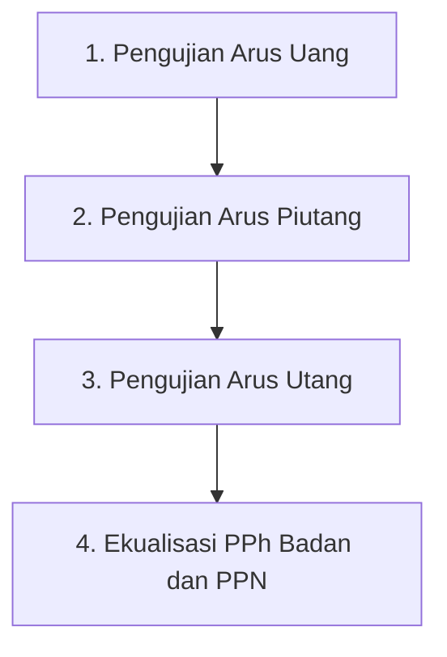

# Learning Path: Pemeriksaan Pajak

**Overview**: A structured journey through teknik pemeriksaan pajak — metode dan teknik pengujian yang digunakan Pemeriksa Pajak untuk menguji kebenaran SPT Wajib Pajak. By the end, you'll understand bagaimana penghasilan bruto, pembelian, dan pos-pos SPT lainnya diuji melalui teknik keterkaitan (arus uang, arus piutang, arus utang), ekualisasi, konfirmasi, dan prosedur pemeriksaan lainnya. Urutan saat ini dimulai dari pengujian arus uang (penghasilan bruto kas basis), lalu pengujian arus piutang (penghasilan bruto akrual), ditutup pengujian arus utang (pembelian kredit dan uang muka pelanggan) — ketiganya saling melengkapi dalam pengujian gabungan arus uang dan utang-piutang — dan diakhiri dengan ekualisasi PPh Badan dan PPN sebagai jembatan antara kepatuhan WP dan teknik pemeriksaan.

**Estimated duration**: ~45 menit per node (chapter terus bertambah seiring ingest sumber baru).

**Prerequisite paths**: [[concept/foundations/_learning-path|Foundations]] (direkomendasikan)

---

## Visual Overview

> **Note**: Click any node in Obsidian to open that concept page. Node berikutnya ditambahkan saat sumber pemeriksaan pajak baru di-ingest.

---

## Path Sequence

### 1. [[pengujian-arus-uang]]
**Prerequisites**: None
**Difficulty**: beginner
**Overview**: Teknik pemeriksaan yang menyusun mutasi kas, bank, dan setara kas untuk mendapatkan jumlah penerimaan uang dalam suatu kurun waktu — mendukung pengujian penghasilan bruto secara kas (cash basis). Konsep ini mencakup formula penerimaan (saldo akhir + pengeluaran − saldo awal), cara alternatif penghitungan sisi penerimaan saja, penyesuaian non penghasilan (transfer antar bank, pinjaman, PPN dipungut sendiri, uang muka pelanggan), serta penanganan khusus PPN dipungut sendiri. Memahami ini penting karena penerimaan kas adalah titik awal seluruh pengujian keterkaitan. By the end of this node, you should be able to menyusun arus uang dan menyaring penerimaan non penghasilan dengan benar.

### 2. [[pengujian-arus-piutang]]
**Prerequisites**: [[pengujian-arus-uang]]
**Difficulty**: intermediate
**Overview**: Teknik untuk menghitung pelunasan piutang usaha dalam suatu periode guna menguji kebenaran penghasilan bruto secara akrual. Konsep ini mencakup dua cara pengujian (mutasi kredit piutang saja, atau gabungan dengan arus uang dan utang-piutang), penyesuaian yang wajib diperhitungkan (penghapusan piutang, retur penjualan, PPN dipungut sendiri, uang muka pelanggan, pendapatan ditangguhkan), serta formula peredaran usaha. Memahami ini penting karena pengujian keterkaitan adalah teknik inti metode pemeriksaan pajak. By the end of this node, you should be able to menyusun arus piutang dan menjelaskan posisinya dalam pengujian gabungan arus uang dan utang-piutang.

### 3. [[pengujian-arus-utang]]
**Prerequisites**: [[pengujian-arus-uang]], [[pengujian-arus-piutang]]
**Difficulty**: intermediate
**Overview**: Teknik pemeriksaan yang menyusun mutasi akun utang untuk meyakini pos yang diuji: pembelian barang secara kredit melalui arus utang usaha, penerimaan pinjaman melalui arus utang bank/afiliasi/pemegang saham, atau penjualan yang sebelumnya diterima sebagai uang muka pelanggan. Konsep ini mencakup formula pembelian (saldo akhir utang + pembelian tunai + pelunasan − saldo awal), formula uang muka penjualan/pelanggan, dan penyesuaian mutasi utang yang tidak terkait pembelian (utang biaya, salah posting, offset). Memahami ini penting karena melengkapi ketiga sisi pengujian keterkaitan. By the end of this node, you should be able to menyusun arus utang usaha untuk menguji pembelian dan memilih akun utang yang tepat sesuai pos yang diuji.

### 4. [[ekualisasi-pph-ppn]]
**Prerequisites**: [[pengujian-arus-utang]]
**Difficulty**: intermediate
**Overview**: Proses memastikan konsistensi angka antara SPT Tahunan PPh Badan dan SPT Masa PPN dalam satu tahun pajak — sisi omset (peredaran usaha 1771 vs total DPP penyerahan 1111) dan sisi pembelian (pembelian/beban 1771 vs DPP Pajak Masukan yang dikreditkan). Konsep ini mencakup cara kerja ekualisasi dua arah, tabel pos-pos penyebab selisih (penghasilan bukan penjualan, PPh final, ekspor, DPP nilai lain, PM yang tidak dapat dikreditkan, capex vs penyusutan, dll), cross-check PPh 23/22, serta kaitannya dengan teknik pengujian keterkaitan — PPN dipungut sendiri dari SPT Masa PPN adalah titik temu omset PPN dan arus kas. Dilengkapi working paper Excel siap isi. Memahami ini penting karena ekualisasi adalah jembatan antara kepatuhan WP dan teknik pemeriksaan: selisih yang tidak dapat dijelaskan adalah awal temuan pemeriksa. By the end of this node, you should be able to menyusun working paper ekualisasi omset & pembelian dan menjelaskan setiap selisih dengan pos-pos yang sah.

---