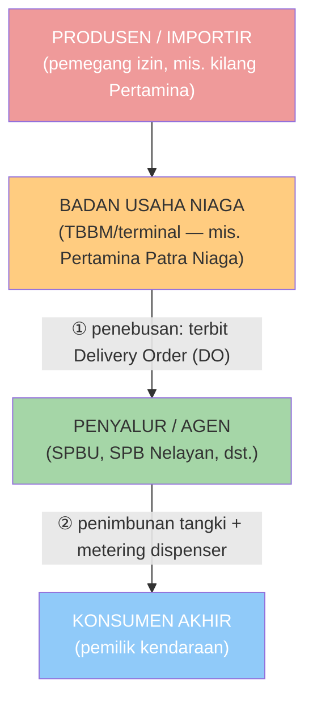
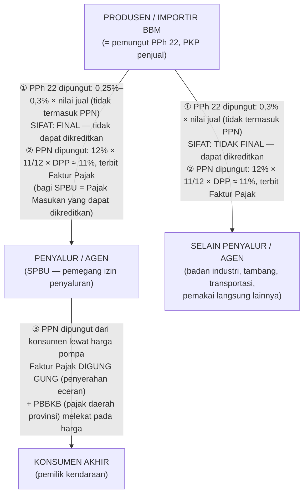

# KLU 47301: Perdagangan Eceran Bahan Bakar di Sarana Pengisian Bahan Bakar

**Summary**: Proses bisnis jual-beli BBM di SPBU melibatkan tiga mata rantai — produsen/importir, penyalur/agen (SPBU), dan konsumen akhir — dan di setiap mata rantainya melekat pajak yang berbeda: PPh 22 dipungut produsen/importir saat penerbitan Delivery Order (final bagi penyalur/agen, tidak final bagi selain penyalur/agen), PPN dikenakan di setiap penyerahan (efektif 11% sejak 2025, dengan Faktur Pajak Digunggung di tingkat eceran), plus PBBKB sebagai pajak daerah yang melekat pada harga BBM kendaraan.

---

## 1. Gambaran usaha dan para pemain

Usaha ini adalah **KLU/KBLI 47301** — *perdagangan eceran bahan bakar minyak (BBM), bahan bakar gas (BBG), LPG, LNG, atau bahan bakar lain di sarana pengisian bahan bakar untuk transportasi darat, laut, dan udara* (SPBU, SPBG, SPB Nelayan, SPB Bunker), biasanya dikombinasikan dengan penjualan pelumas dan produk lain (source: KBLI-47301).

Pihak-pihak yang terlibat (source: Permen-ESDM-13-2018):

| Pelaku | Peran | Izin |
|--------|-------|------|
| **Produsen / importir** BBM | Mengolah minyak bumi atau mengimpor; pemegang izin usaha yang berhak menjual | Izin usaha (kegiatan hilir, UU 22/2001 — badan usaha, bukan perorangan) |
| **Badan Usaha Niaga** (mis. Pertamina Patra Niaga) | Mendistribusikan BBM ke penyalur | Izin Usaha Niaga dari Ditjen Migas ESDM |
| **Penyalur / agen** (SPBU, SPB Nelayan, dll.) | Membeli dari BU Niaga lalu menjual eceran ke konsumen | Izin penyaluran; bentuk penyalur: agen BBM, SPBU, SPB Nelayan, SPB Bunker |
| **Konsumen akhir** | Pemilik kendaraan / pemakai BBM | — |

## 2. Alur proses bisnis

Tahapannya:

1. **Penebusan (saat terbit DO)** — SPBU memesan BBM ke Badan Usaha Niaga; BU Niaga menerbitkan **Delivery Order (surat perintah pengeluaran barang)**. **Inilah saat kunci perpajakan: PPh 22 terutang dan dipungut pada saat penerbitan DO** (source: PMK-51-2025).
2. **Pengiriman & penimbunan** — BBM diangkut mobil tangki (MT) dari terminal ke tangki pendam SPBU; volume penjualan diukur dispenser (meteran tera ulang).
3. **Penjualan eceran** — konsumen membeli di pompa (tunai/kartu/QR); untuk BBM tertentu (subsidi) harga mengikuti ketentuan pemerintah dan kuota, untuk BBM non-subsidi harga mengikuti pasar.
4. **Penghasilan pengusaha SPBU** = marjin (harga eceran − harga pokok) + komisi (untuk BBM bersubsidi) + pendapatan non-BBM (minimarket, cuci kendaraan, dll.).

## 3. Peta pajak di setiap mata rantai

## 4. Ulasan tiap unsur pajak

### 4.1 PPh Pasal 22 — dipungut oleh produsen/importir

**Pemungut**: produsen atau importir BBM, BBG, dan pelumas. **Yang dipungut**: pembeli BBM (SPBU/penyalur maupun pihak lain). **Saat pemungutan**: penerbitan surat perintah pengeluaran barang (DO) (source: PMK-51-2025).

**Tarif** (dasar = nilai penjualan **tidak termasuk PPN**) (source: PMK-51-2025; struktur sama dengan PMK 34/2017 dan PMK 41/2022):

| Pembeli | Tarif |
|---------|-------|
| SPBU yang menjual BBM yang dibeli dari **PT Pertamina (Persero) atau anak usahanya** | **0,25%** |
| SPBU yang menjual BBM yang dibeli **selain dari Pertamina/anak usahanya** | **0,3%** |
| **Selain SPBU** (agen penyalur, pembeli langsung lainnya) | **0,3%** |

**Final vs tidak final — ini kunci yang sering tertukar:**

> ⚠️ Yang berlabel **final/tidak final adalah PPh 22**, **bukan PPN**. PPN tidak pernah "final" — penjelasannya di bagian 4.2.

- Penjualan BBM/BBG kepada **penyalur/agen** → PPh 22 bersifat **FINAL**: pemungutan menjadi pelunasan pajak yang berdiri sendiri; **tidak dapat dikreditkan** oleh penyalur/agen di SPT Tahunan, dan penghasilan atas transaksi tersebut tidak dihitung lagi sebagai objek PPh tidak final (source: PMK-51-2025).
- Penjualan BBM/BBG kepada **selain penyalur/agen** → PPh 22 bersifat **TIDAK FINAL**: pemungutan hanya angsuran (prepayment) — pembeli memperoleh **bukti pungut** dan **mengkreditkannya** sebagai kredit pajak di SPT Tahunan (source: PMK-51-2025).
- Penjualan **pelumas** → selalu tidak final.

**"Selain penyalur/agen" itu siapa? Apakah berarti semua badan?**

Bukan. Yang menentukan bukan bentuk badan/orang pribadi, melainkan **status pembeli sebagai penyalur/agen berizin atau tidak**:

- Pembeli yang **punya izin penyaluran/keagenan BBM** (SPBU, SPB Nelayan, agen) = "penyalur/agen" → PPh 22 final.
- Pembeli yang **tidak punya izin penyaluran** — siapa pun dia: badan usaha industri, pertambangan, transportasi, maupun pemakai langsung lain yang membeli BBM langsung dari produsen/importir = "selain penyalur/agen" → PPh 22 tidak final.

Dalam praktik, "selain penyalur/agen" ini **lazimnya badan usaha** (perusahaan yang membeli BBM untuk keperluan operasionalnya langsung dari produsen/importir), tetapi istilah hukumnya bukan "badan" — melainkan "pihak yang bukan penyalur/agen" (source: PMK-51-2025; PMK-34-2017).

**Sifat "pungutan di muka"**: karena dipungut saat DO (sebelum barang dikirim), pengusaha SPBU praktis sudah "membayar pajak" lebih dulu — harga beli dari BU Niaga sudah bersih dari potongan PPh 22, dan atas pembelian itu ia menerima bukti pemungutan dan faktur pajak.

### 4.2 PPN — dikenakan di **setiap** mata rantai (tidak ada PPN "final")

BBM adalah **Barang Kena Pajak (BKP)**, sehingga setiap penyerahannya (produsen → agen, agen → konsumen) dikenai PPN (source: UU NO 6 2023-PAJAK PERTAMBAHAN NILAI.md).

- **Produsen → SPBU/penyalur**: produsen memungut PPN dan menerbitkan **Faktur Pajak** (DPP nilai lain 11/12 × harga jual); bagi SPBU, PPN ini menjadi **Pajak Masukan yang dapat dikreditkan** terhadap PPN keluaran.
- **SPBU → konsumen akhir: YA, ada PPN.** PPN dipungut dari konsumen **melalui harga jual di pompa** (harga sudah termasuk PPN). Karena penyerahan eceran kepada masyarakat, SPBU (PKP) menerbitkan **Faktur Pajak Digunggung** (satu faktur ringkasan per masa pajak) (source: PMK-34-2017; ketentuan faktur digunggung).
- **Mengapa tidak ada "PPN final"?** PPN bekerja dengan mekanisme **kredit pajak** (pajak masukan dikurangkan dari pajak keluaran), bukan mekanisme final. Yang final/tidak final hanya memengaruhi *PPh* (bisa atau tidaknya PPh 22 dikreditkan). PPN selalu dikreditkan di setiap rantai sampai ke konsumen akhir yang menanggung beban PPN.

**Tarif PPN sejak 2025**: tarif PPN 12% namun untuk BKP selain kendaraan bermotor mewah dihitung dengan **DPP nilai lain 11/12** sehingga **efektif 11%**: `PPN = 12% × 11/12 × DPP (harga jual belum PPN)` (source: PMK-131-2024; PMK-11-2025; PMK-51-2025 lampiran terkait). DPP PPN atas BBM = harga jual (harga eceran) (source: UU NO 6 2023-PAJAK PERTAMBAHAN NILAI.md).

### 4.3 PBBKB — pajak daerah yang melekat di harga pompa

**Pajak Bahan Bakar Kendaraan Bermotor (PBBKB)** adalah pajak daerah provinsi: dibayar konsumen sebagai bagian dari harga BBM kendaraan bermotor, dipungut oleh pengusaha yang menjual BBM kendaraan (termasuk SPBU), dan disetorkan ke pemerintah daerah — bukan ke DJP (UU 1/2022 tentang HKPD). Tarif ditetapkan melalui Perda.

### 4.4 PPh atas penghasilan pengusaha SPBU

Marjin, komisi, dan pendapatan lain SPBU adalah penghasilan usaha biasa: dikenai **PPh normal** (angsuran PPh 25 dan PPh 29 di SPT Tahunan). Wajib Pajak UMKM dengan peredaran bruto sampai Rp4,8 miliar dapat memilih dikenai **PPh final 0,5%** (PP 55/2022) — jarang relevan untuk SPBU karena peredaran bruto umumnya jauh di atas batas itu.

## 5. Ilustrasi angka

Misal: produsen menjual BBM senilai **Rp100.000.000** (belum termasuk PPN) dengan terbit DO.

**a. Penjualan ke SPBU yang BBM-nya dari Pertamina (tarif 0,25%):**

- PPh 22 = 0,25% × Rp100.000.000 = **Rp250.000** → **final** (tidak bisa dikreditkan SPBU).
- PPN = 12% × 11/12 × Rp100.000.000 = **Rp11.000.000** → menjadi Pajak Masukan SPBU yang dapat dikreditkan.

**b. Penjualan ke badan industri (selain penyalur/agen, tarif 0,3%):**

- PPh 22 = 0,3% × Rp100.000.000 = **Rp300.000** → **tidak final** → badan industri mengkreditkannya di SPT Tahunan (memerlukan bukti pungut).
- PPN = 12% × 11/12 × Rp100.000.000 = **Rp11.000.000** (Faktur Pajak).

**c. SPBU menjual eceran: harga pompa sudah termasuk PPN** (mis. Rp12.500/liter termasuk PPN → PPN ≈ 11% dari harga belum PPN; jika harga belum PPN Rp10.000/liter, PPN = Rp1.100/liter ≈ 11% efektif), dilaporkan dengan Faktur Pajak Digunggung; Pajak Masukan dari pembelian (bagian a) dikreditkan. Di atas itu, harga juga memuat PBBKB sesuai ketentuan daerah.

## 6. Kewajiban administrasi

| Kewajiban | Ketentuan |
|-----------|-----------|
| Setor PPh 22 (oleh pemungut: produsen/importir) | Paling lambat **tanggal 10** bulan berikutnya; KAP 411122 (KJS 401 untuk penjualan kepada agen/penyalur, KJS 100 untuk selainnya) |
| Bukti pemungutan PPh 22 | Diterbitkan pemungut (aplikasi e-Bupot Unifikasi / e-Bupot 22) |
| Lapor PPh 22 (pemungut) | SPT Masa Unifikasi paling lambat **tanggal 20** bulan berikutnya |
| PPN (SPBU sebagai PKP) | SPT Masa PPN; penyerahan eceran dengan FP Digunggung; PM dari pembelian BBM dikreditkan |
| PBBKB | Disetor oleh pengusaha penjual BBM kendaraan ke kas daerah provinsi |

## 7. Hal yang perlu diverifikasi

- Artikel edukasi lama (Pajakku, DDTC 2023–2024) masih merujuk **PMK 34/2017 s.t.d.d. PMK 41/2022**; sejak 25 Juli 2025 kerangka PPh 22 diatur **PMK 51/2025** dengan struktur tarif dan saat pemungutan yang dipertahankan (source: PMK-51-2025).
- Perlakuan PPN atas **BBM bersubsidi tertentu** (harga ditetapkan pemerintah, kuota) perlu dicek terhadap ketentuan khusus yang berlaku saat itu; halaman ini membahas kerangka umum BBM sebagai BKP.
- Daftar tarif KJS dan batas tarif PBBKB sebaiknya dikonfirmasi ke ketentuan terkini saat digunakan untuk pekerjaan nyata.

## Related pages

- [[concept/probis/_learning-path|Learning Path: Proses Bisnis (KLU)]]
- [[concept/pajak-penghasilan/pph-21-bpjs|PPh 21 dan BPJS]] (mekanisme pemotongan PPh lain: PPh 21)
- [[concept/pemeriksaan-pajak/pengujian-arus-piutang|Pengujian Arus Piutang]] (bagaimana pemeriksa menguji penghasilan bruto penjualan)
- [[_learning-path|Master Learning Path]]

## Sumber

- PMK 51/2025 — Pemungutan PPh 22 (jdih.kemenkeu.go.id/dok/pmk-51-tahun-2025)
- PMK 34/2017 s.t.d.d. PMK 41/2022 — kerangka PPh 22 BBM sebelumnya
- PMK 131/2024 & PMK 11/2025 — tarif PPN 12% dengan DPP nilai lain 11/12
- UU 22/2001 tentang Migas & Permen ESDM 13/2018 — rantai hilir dan bentuk penyalur
- KBLI 2020 47301 — klasifikasi usaha perdagangan eceran bahan bakar di sarana pengisian bahan bakar
- UU 1/2022 (HKPD) — PBBKB sebagai pajak daerah
- Artikel: DDTCNews "Beli BBM saat Mudik Lebaran" (formula PPN 2025), Pajakku "Ketentuan Perpajakan Pengusaha SPBU", BNK Tax Consulting "Aspek Pajak Usaha SPBU"