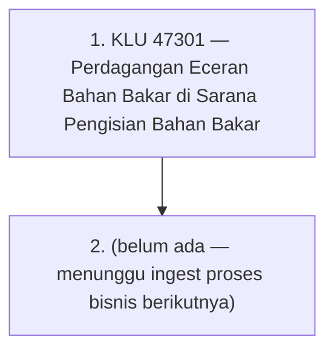

# Learning Path: Proses Bisnis (KLU)

**Overview**: Perjalanan terstruktur memahami **proses bisnis sesuai klasifikasi lapangan usaha (KLU/KBLI)** dan unsur perpajakan yang melekat di setiap mata rantainya — siapa pemungut/pemotongnya, tarifnya, bersifat final atau tidak, serta kewajiban administrasinya. Dimulai dari KLU 47301 (perdagangan eceran bahan bakar di sarana pengisian bahan bakar): rantai produsen/importir → penyalur/agen (SPBU) → konsumen akhir, dengan PPh 22 yang dipungut saat Delivery Order, PPN di setiap penyerahan (efektif 11% sejak 2025), dan PBBKB sebagai pajak daerah. Chapter akan bertambah seiring ingest KLU/proses bisnis baru.

**Estimated duration**: ~25 menit per node (chapter terus bertambah seiring ingest sumber baru).

**Prerequisite paths**: [[concept/foundations/_learning-path|Foundations]] (direkomendasikan), pengenalan dasar PPh dan PPN membantu

---

## Visual Overview

> **Note**: Click any node in Obsidian to open that concept page. Node berikutnya ditambahkan saat proses bisnis KLU baru di-ingest.

---

## Path Sequence

### 1. [[47301-perdagangan-eceran-bahan-bakar-di-sarana-pengisian-bahan-bakar]]
**Prerequisites**: None
**Difficulty**: beginner
**Overview**: Proses bisnis jual-beli BBM di SPBU (KLU 47301) dan unsur perpajakannya. Halaman ini menjelaskan rantai pelaku (produsen/importir, badan usaha niaga, penyalur/agen, konsumen akhir), alur penebusan BBM sampai penjualan eceran, serta peta pajak di tiap mata rantai: PPh 22 yang dipungut produsen/importir saat penerbitan Delivery Order (tarif 0,25%–0,3%, final bagi penyalur/agen dan tidak final bagi selain penyalur/agen), PPN yang dikenakan di setiap penyerahan dengan tarif efektif 11% (DPP nilai lain 11/12, Faktur Pajak Digunggung di eceran), PBBKB sebagai pajak daerah, dan PPh normal atas marjin pengusaha SPBU. Dilengkapi ilustrasi angka dan jadwal setor-lapor. By the end of this node, you should be able to menjelaskan siapa pemungut pajak di setiap mata rantai BBM, membedakan PPh 22 final vs tidak final, dan menghitung PPh 22 serta PPN atas penyerahan BBM.

---